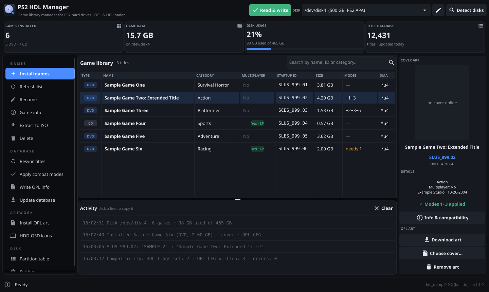
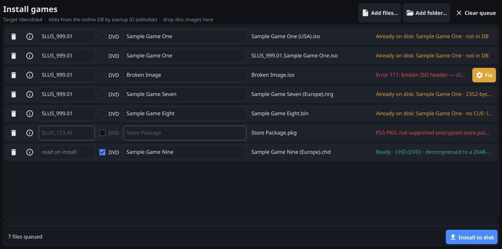
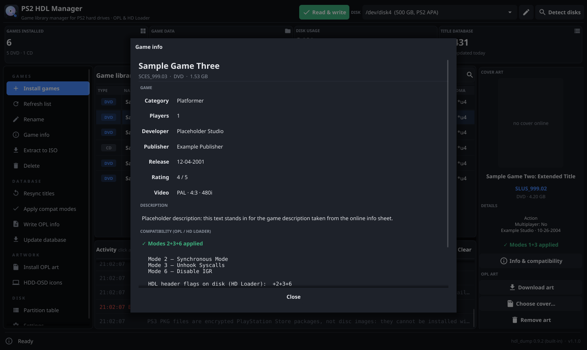
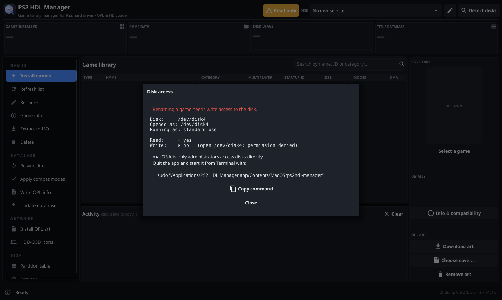

# ps2hdl-manager

**PS2 HDL Manager**: a graphical game library manager for PlayStation 2 hard drives (HD Loader and Open PS2 Loader).
It installs games from ISO, CUE/BIN, CHD, CSO, Nero and other image formats, keeps titles in sync with an online database, and manages OPL artwork, info sheets and compatibility modes. One executable for macOS, Windows and Linux, with no external tools to install.



<sub>Screenshot with sample data.</sub>

---

## Contents

- [Features](#features)
- [Supported formats](#supported-formats)
- [Requirements](#requirements)
- [Building](#building)
- [Running and disk permissions](#running-and-disk-permissions)
- [Quick start](#quick-start)
- [Application data](#application-data)
- [Troubleshooting](#troubleshooting)
- [Project layout](#project-layout)
- [License and credits](#license-and-credits)
- [Disclaimer](#disclaimer)
- [Support](#support)

---

## Features

**Game library**
- Lists the games on the PS2 disk with type (CD/DVD), genre, multiplayer, startup ID, size, compatibility modes and DMA; search by name, ID or genre.
- Fast, direct disk reading: the APA partition table is read by the app itself, with the same results as `hdl_dump`.
- Rename, delete (partition, artwork and OPL settings together), extract to ISO, HDL header details.

**Installing**
- Install queue with many files or whole folders, also by dragging them onto the window.
- Startup ID read from the image, title taken from the online database (editable), CD/DVD detected.
- Image diagnostics: hdl_dump errors 111/112 are recognised before installing; ISOs with a broken path table are repaired with one click.
- After installing: OPL artwork, info sheet and recommended compatibility modes are written automatically.
- Title and 3D icon for the **HDD-OSD** (the PS2 Browser 2.0) are written into the partition header while installing.

**Database and titles**
- Titles and genres from [GameDB-PS2](https://github.com/niemasd/GameDB-PS2), cached and refreshed periodically.
- **Resync** of all titles on the disk, with a preview of the changes; renames applied in a single pass.
- Info sheet for every game (developer, publisher, release date, players, video, description, recommended modes).

**OPL**
- **OPL artwork** in `+OPL/ART`, as PNG as required by OPL 1.2 and later: front cover, disc icon, background and two screenshots (the default theme's), plus back cover, spine and logo for custom themes. Types are chosen in Settings. Sources: [ps2-covers](https://github.com/xlenore/ps2-covers) for the front cover and the OPL Manager art backup on archive.org for the rest (read piece by piece: only the pictures needed are downloaded). Covers can also be set from a file. Old JPG covers, ignored by OPL 1.2, are replaced.
- **Info sheet** in `+OPL/CFG/<ID>.cfg` for OPL's info page: genre, players, developer, publisher, release date, rating, video mode, aspect ratio, scan mode, description. Valid values already there are kept; invalid ones (e.g. text in place of the video mode) are corrected. `$Compatibility` is written separately, merged with existing settings.
- Database → **Write OPL game info** updates the info sheets of all games without touching the compatibility modes.
- Compatibility flags are also written to the HDL header for HD Loader.

**HDD-OSD (Browser 2.0)**
- Line 1: game name · line 2: ID and region (e.g. `SLUS-12345 (NTSC-U)`).
- 3D icon from the [icon pack](https://github.com/luissilva1044894/Icon-pack-for-HDL-Batch-installer) (MIT licence, about 4,500 games); games without one keep their current icon.
- Also updated after renaming and resyncing; Artwork → **Write HDD-OSD titles & icons** writes them for games already installed, all in one pass.

**Tools and safety**
- CHD → 2048-byte DVD CHD conversion (also from old CHD v3/v4) and CHD → ISO extraction.
- **Permission check** on the disk, with instructions for your system; write operations are blocked up front when permissions are missing.
- **One-click repair** of partition IDs damaged by older renaming tools.
- Protected formatting: refused on disks with mounted volumes, explicit confirmation required.
- Persistent activity log (click a line to copy it) and crash log.

| Installing | Game info | Disk permissions |
|---|---|---|
|  |  |  |

## Supported formats

| Format | Extensions | Notes |
|---|---|---|
| ISO | `.iso` | used as is when already 2048-byte; error 111 repairable with **Fix** |
| UDF | `.udf` | UDF-bridge images (ISO9660 + UDF, like PS2 DVDs); UDF-only images are recognised and explained (ID read from the UDF file system) |
| BIN/CUE | `.cue` + `.bin` | MODE1/MODE2 tracks at 2352/2336/2048, pregap (`INDEX 00`), multiple files; audio tracks are reported and not installed |
| BIN, IMG | `.bin` `.img` | without a CUE: sector layout detected from the data |
| CSO / ZSO | `.cso` `.zso` | CSO v1 and v2 (deflate and LZ4), ZSO (LZ4); decompressed while installing |
| Nero | `.nrg` | v1 and v2, DAO and TAO |
| Alcohol 120% | `.mds` + `.mdf` | MDS 1.x descriptor; `.mdf` also on its own (layout from the data) |
| CloneCD | `.ccd` + `.img` + `.sub` | the `.sub` (subchannel) file is not needed |
| CHD | `.chd` | CHD v3, v4 and v5 (CD and DVD; also DVDs stored as "hard disk" CHDs by old tools) |
| Global Image, IML | `.gi` `.iml` | read directly by hdl_dump |
| PKG | `.pkg` | recognised and refused: encrypted store packages, not disc images |

**The PS2 disk always gets 2048-byte sectors.** Images with raw sectors (2352-byte MODE1/MODE2, 2336, 2448 with subchannel), compressed images and images inside other containers are converted to a temporary 2048-byte ISO in the work folder; before writing, the app checks that the result really is a 2048-byte ISO. The only exception is GI and IML, which hdl_dump reads and converts itself.

The files of one image (CUE+BIN, MDS+MDF, CCD+IMG+SUB) are queued only once, even when dropping the whole folder. Formats are also recognised by their content (an `.iso` that is really a Nero image, a CSO or a CHD), and when a file is not a disc image the app says what it is (ZIP/RAR/7z archive, ECM file, empty file…).

When an image has a problem, the Activity log shows the file, the format, the reason and the details of the analysis (sector layout, tracks, what was looked for).

Every format is a plug-in: adding one takes a single file, see [docs/DEVELOPMENT.md](docs/DEVELOPMENT.md#adding-an-image-format).

## Requirements

- **macOS** 11 or later (Apple Silicon or Intel), **Windows** 10/11 x64, or **Linux** with a graphical desktop.
- A PS2 hard drive (APA format) connected to the computer, e.g. through a USB-IDE/SATA adapter.
- To build: Go ≥ 1.24, a C compiler and `make` (details below).

hdl_dump, pfsshell and the CHD codec are **built into the application**: there is nothing else to install.

## Building

```bash
git clone https://github.com/freshness79/ps2hdl-manager.git
cd ps2hdl-manager
make            # build for this system → bin/ps2hdl-manager
make run        # build and start
make help       # all available targets
```

| System | Prerequisites | Command |
|---|---|---|
| macOS | `xcode-select --install` | `make macapp` → `bin/PS2 HDL Manager.app` (unsigned) |
| Windows (cross-build from macOS/Linux) | `mingw-w64` | `make windows` → `bin/ps2hdl-manager.exe` |
| Linux | `gcc`, `libgl1-mesa-dev`, `xorg-dev` | `make` |

`make dist` creates the release archives (executable, README, licences) and the source archive in `dist/`.

## Running and disk permissions

Direct access to a physical disk needs administrator rights:

- **macOS**: start the app from Terminal with `sudo`:
  ```bash
  sudo "bin/PS2 HDL Manager.app/Contents/MacOS/ps2hdl-manager"
  ```
  If a volume of the disk is mounted, unmount it while leaving the disk attached: `diskutil unmountDisk /dev/diskN`.
- **Windows**: the executable asks to run as administrator by itself. Disks are named `hdd1:`, `hdd2:`…
- **Linux**: `sudo`, or add your user to the `disk` group (`sudo usermod -aG disk $USER`, then log in again).

The indicator next to the disk selector shows straight away what the app can do: **Read & write**, **Read only** or **No access**. Clicking it explains why and how to fix it, with the command ready to copy.

The app is purely graphical: it has no command-line options and writes nothing to the terminal; even when started from a terminal, closing the terminal does not close it.

## Quick start

1. **Select the disk**: *Detect disks* (or *Disk → Set device manually…*). If the disk is not formatted for the PS2: *Disk → Initialize / format PS2 disk…*
2. **Install games**: *Install games* → add files or folders (or drop them) → check ID, title and CD/DVD → *Install to disk*.
3. **Consistent titles**: *Resync titles* compares the names on the disk with the database and applies only the changes you select.
4. **OPL**: *Install OPL art* for the artwork, *Apply compat modes* for the recommended compatibility modes, *Write OPL info* for the info sheets.
5. **Maintenance**: if the **Repair N IDs** button appears, one click repairs damaged partition IDs.

Main menus: **File** (settings) · **Disk** (detection, partition table, permissions, ID repair, formatting) · **Games** · **Database** · **Artwork** · **Tools** (CHD) · **Help** (built-in tools, logs) · **About** (version, licences).

## Application data

Everything lives in the user configuration folder, sub-folder `ps2hdl-manager`:

| System | Folder |
|---|---|
| macOS | `~/Library/Application Support/ps2hdl-manager` |
| Windows | `%AppData%\ps2hdl-manager` |
| Linux | `~/.config/ps2hdl-manager` |

| File | Contents |
|---|---|
| `config.json` | settings |
| `titles-cache.json`, `info/`, `art/` | caches of the database, game info and OPL artwork |
| `art-index/` | index of the OPL Manager art backup (read once, a few MB) |
| `hddosd/` | index and 3D icons for the HDD-OSD |
| `ps2hdl.log` | activity log (rotated at 5 MB) |
| `crash.log` | fatal errors, if any |

With `sudo` the folder is root's. *Help → Log files location* shows the paths in use. On first start, data of earlier versions (folder `ps2hdl-gui`) is moved over automatically.

### Online sources

*File → Settings → Online sources* lets you change every source: title database, front covers, archive of the other OPL artwork (icons, backgrounds, screenshots…), info sheets, compatibility database and HDD-OSD icons. Every field has a *Default* button; optional ones are turned off by leaving them empty. In per-game URLs `{ID}` becomes `SLUS-12345` and `{STARTUP}` becomes `SLUS_123.45`.

## Troubleshooting

| Symptom | Cause and fix |
|---|---|
| **Read only** / **No access** indicator | Missing permissions: see [Running and disk permissions](#running-and-disk-permissions); the indicator's dialog has the details. |
| *Error 111: broken ISO header* | Invalid path table (rebuilt or patched ISOs): **Fix** creates a repaired copy, the original is left untouched. |
| *Enter the startup ID* (error 112) | The image does not declare a standard ID: enter it by hand (e.g. `SLUS_123.45`). |
| *partition ID has leftover bytes* warnings | Partition IDs damaged by older tools: **Repair N IDs** button. |
| *… is not a PlayStation 2 (APA) disk* | Disk not formatted for the PS2: *Disk → Initialize / format PS2 disk…* (erases everything). |
| Covers not shown by OPL 1.2 or later | OPL only reads PNG: Artwork → *Re-download all OPL art (replace)* replaces the old JPGs. *List OPL art on disk* tells how many JPGs are left. |
| *OPL Manager art archive: …* in the log | archive.org slow or unreachable: the front cover still comes from ps2-covers, the other pictures on the next attempt (after 5 minutes). The archive can be changed or turned off in Settings. |
| CHD *not supported* | CHD v1/v2 (hard disks only), laserdisc CHDs or "diff" CHDs that need a parent file: none of them is a usable PS2 game image. |

When reporting a problem, please attach `ps2hdl.log` and `crash.log`.

## Project layout

```
cmd/ps2hdl-manager/    main program (+ Windows resources: icon, administrator manifest, version)
internal/
  ui/                  graphical interface (Fyne)
  tools/               hdl_dump, pfsshell, batch command, CHD: wrappers and child processes
  formats/             registry of the image format plug-ins
  formats/builtin/     plug-ins: ISO, UDF, CUE/BIN, BIN/IMG, CSO/ZSO, NRG, MDF/MDS, CCD, CHD, GI/IML, PKG
  disc/                disc image analysis (startup ID, errors 111/112, sector layouts, repairs)
  gamedb/              title database, game info/compatibility, OPL artwork, HDD-OSD data
  system/              system disks, permission checks, console detachment
  config/              settings
  apa/                 reader of the PS2 (APA) partition table and HDL headers
  chd/                 CHD codec (read v3–v5, write v5)
  hdldump/ pfsshell/   hdl_dump and pfsshell compiled into the app (cgo)
  buildinfo/           version, source and donation URLs (set by the Makefile)
  testenv/             test support (sample PS2 image, synthetic image builders)
third_party/           sources of hdl-dump, pfsshell, go-locale (with local patches)
assets/                app icon (SVG source and rendered sizes), Linux .desktop file
licenses/              licence notices of the bundled components
scripts/               licence notices, icons, reference test images
docs/                  technical documentation and screenshots
```

Architecture, tests, releases and adding new formats: **[docs/DEVELOPMENT.md](docs/DEVELOPMENT.md)**.

## License and credits

Copyright © 2026 freshness.

PS2 HDL Manager is free software, released under the **GNU General Public License version 2 or later** ([LICENSE](LICENSE)), without any warranty. Whoever distributes the executable must also make the source code available.

It includes or builds on:
- [hdl-dump](https://github.com/ps2homebrew/hdl-dump) (GPL-2.0-or-later) and [pfsshell](https://github.com/ps2homebrew/pfsshell) (GPL-2.0, ps2sdk parts AFL-2.0), with small fixes documented in [third_party/PATCHES.md](third_party/PATCHES.md);
- the CHD format of [MAME](https://github.com/mamedev/mame) (BSD-3-Clause);
- [Fyne](https://fyne.io) and the other libraries listed, with the full licence texts, in [licenses/THIRD_PARTY_NOTICES.txt](licenses/THIRD_PARTY_NOTICES.txt) (also in *About → Third-party licenses*).

Online data used at run time, subject to the terms of each project: [GameDB-PS2](https://github.com/niemasd/GameDB-PS2), [PS2-OPL-CFG-Database](https://github.com/Tom-Bruise/PS2-OPL-CFG-Database), [PS2-OPL-CFG-Compatibility-Database](https://github.com/GDX-X/PS2-OPL-CFG-Compatibility-Database), [ps2-covers](https://github.com/xlenore/ps2-covers), the [OPL Manager](https://archive.org/details/OPLM_ART_2024_09) art backup (archive.org), [Icon pack for HDL Batch installer](https://github.com/luissilva1044894/Icon-pack-for-HDL-Batch-installer) (MIT).

## Disclaimer

This software is provided **"as is", without warranty of any kind**. To the maximum extent permitted by law, the author is **not liable for any damage or loss** (including loss of data or damage to hardware) arising from its use or misuse, and **you alone are responsible** for how you use it and for complying with the laws that apply to you, including copyright law. It is intended for managing legally obtained games, such as backups of discs you own; it does not circumvent copy protection and does not provide any game, BIOS or firmware. It writes directly to disk devices: always keep a backup and double-check the selected disk.

"PlayStation" and "PS2" are registered trademarks or trademarks of Sony Interactive Entertainment Inc. This project is not affiliated with, endorsed or sponsored by Sony. Full text: **[DISCLAIMER.md](DISCLAIMER.md)**.

## Support

The program is free and will stay free. Bug reports and suggestions: [Issues](https://github.com/freshness79/ps2hdl-manager/issues). If it saves you time and you would like to buy the author a coffee, the *Sponsor* button is at the top of the repository page (and in *About*): entirely optional.
